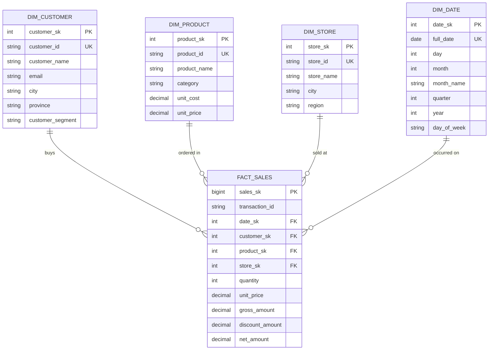

# ISSUE: Implementasi Mini Data Warehouse Menggunakan Apache Hop & MySQL

## 1. Deskripsi & Tujuan Project

### 1.1 Deskripsi
Project ini merupakan demonstrasi end-to-end implementasi **Mini Data Warehouse (DWH)** dengan arsitektur **Star Schema** pada basis data **MySQL/MariaDB**, menggunakan **Apache Hop** sebagai platform integrasi data dan orkestrasi ETL (Extract, Transform, Load).

Sumber data transaksional akan dibuat secara sintetis (*dummy generator*) menggunakan script Python yang mensimulasikan sistem penjualan retail (TBS Food / Retail Sales). Apache Hop akan mengekstrak data mentah, melakukan pembersihan (*data cleansing*), transformasi, pembangkitan *surrogate key*, pengisian dimensi (*dimension tables*), hingga pemuatan data ke tabel fakta (*fact table*).

### 1.2 Tujuan
1. **Demonstrasi Kapabilitas Apache Hop**: Menampilkan alur ETL modern menggunakan konsep Hop Pipelines (`.hpl`) untuk transformasi data dan Hop Workflows (`.hwf`) untuk orkestrasi alur kerja.
2. **Implementasi Star Schema Data Warehouse**: Membangun model dimensional yang terdiri dari tabel dimensi (`dim_customer`, `dim_product`, `dim_store`, `dim_date`) dan satu tabel fakta (`fact_sales`).
3. **Automasi End-to-End**: Menyediakan pipeline yang dapat dieksekusi secara otomatis baik via Hop GUI maupun Hop CLI (`hop-run.bat`), siap dijalankan oleh Agent AI maupun cron/scheduler.
4. **Validasi Analitik**: Menyediakan query analitik bisnis (misal: tren penjualan bulanan, produk terlaris, kontribusi penjualan per kota/region) untuk membuktikan integritas Data Warehouse.

---

## 2. Tech Stack & Environment

| Komponen | Teknologi | Versi / Keterangan |
| :--- | :--- | :--- |
| **ETL Engine** | Apache Hop | v2.18.1 (Lokasi: `C:\hop`) |
| **Runtime Engine** | Java JDK | OpenJDK / Oracle Java 18 |
| **Database RDBMS** | MySQL / MariaDB | MariaDB 10.4 (XAMPP, `localhost:3306`, user: `root`) |
| **Database Driver** | MySQL Connector/J | JDBC Driver `mysql-connector-j-8.x.jar` (di `C:\hop\lib`) |
| **Dummy Data Generator** | Python | Python 3.14+ (Standard library: `csv`, `random`, `datetime`, `uuid`) |
| **OS Environment** | Windows 10/11 | PowerShell / CMD |

---

## 3. Desain Model Data Warehouse (Star Schema)



---

## 4. Struktur Direktori Project

```text
apache-hop-agy/
├── issue.md                          # Dokumen spesifikasi & roadmap tugas (dokumen ini)
├── README.md                         # Dokumentasi instruksi & panduan menjalankan project
├── data/
│   ├── raw/                          # File CSV hasil generate dummy data
│   │   ├── raw_customers.csv
│   │   ├── raw_products.csv
│   │   ├── raw_stores.csv
│   │   └── raw_transactions.csv
├── scripts/
│   ├── generate_dummy_data.py        # Generator data penjualan retail sintetis
│   ├── setup_mysql_driver.py         # Skrip otomatis unduh connector MySQL ke C:\hop\lib
│   └── run_pipeline.bat              # Shortcut menjalankan ETL via hop-run.bat
├── sql/
│   ├── 01_init_databases.sql         # Inisialisasi database staging & data warehouse
│   ├── 02_create_dimensions.sql      # DDL pembuatan tabel dimensi
│   ├── 03_create_fact.sql            # DDL pembuatan tabel fakta
│   └── 04_analytics_queries.sql      # Kueri verifikasi dan laporan analitik bisnis
└── hop/
    ├── project-config.json           # Definisi metadata Hop Project
    ├── metadata/
    │   └── rdbms/                    # Koneksi database Hop ke MySQL
    │       ├── mysql_staging.json
    │       └── mysql_dwh.json
    ├── pipelines/
    │   ├── load_dim_customer.hpl     # Pipeline ETL Dimensi Customer
    │   ├── load_dim_product.hpl      # Pipeline ETL Dimensi Product
    │   ├── load_dim_store.hpl        # Pipeline ETL Dimensi Store
    │   ├── load_dim_date.hpl         # Pipeline ETL Dimensi Date
    │   └── load_fact_sales.hpl       # Pipeline ETL Fakta Penjualan (Lookup SK + Aggregasi)
    └── workflows/
        └── main_etl_workflow.hwf     # Workflow master yang mengeksekusi seluruh pipeline
```

---

## 5. Rencana Langkah-Langkah Eksekusi (Action Plan untuk AI Agent)

Agent AI dapat mengeksekusi project ini secara sekuensial mengikuti tahapan berikut:

### Tahap 1: Persiapan Environment & Driver Database
- [x] **1.1. Cek Koneksi MySQL**: Pastikan servis MySQL di `localhost:3306` aktif (XAMPP).
- [x] **1.2. Download MySQL Connector/J**: Buat script `scripts/setup_mysql_driver.py` untuk mengunduh `mysql-connector-j-8.x.jar` dari Maven Central dan menyimpannya ke `C:\hop\lib` jika belum ada.
- [x] **1.3. Uji Validitas Hop CLI**: Jalankan `C:\hop\hop-conf.bat --version` atau cek ketersediaan Hop CLI.

### Tahap 2: Inisialisasi Database & Skema Star Schema
- [x] **2.1. Buat Database**: Eksekusi `sql/01_init_databases.sql` untuk membuat basis data `food_staging` dan `food_dwh`.
- [x] **2.2. Buat DDL Tabel Dimensi**: Eksekusi `sql/02_create_dimensions.sql` pada basis data `food_dwh` (`dim_customer`, `dim_product`, `dim_store`, `dim_date`).
- [x] **2.3. Buat DDL Tabel Fakta**: Eksekusi `sql/03_create_fact.sql` pada basis data `food_dwh` (`fact_sales`) lengkap dengan *foreign key* dan *indexing*.

### Tahap 3: Pembuatan Generator Dummy Data
- [x] **3.1. Buat Script `generate_dummy_data.py`**:
  - Menghasilkan 200 data customer dengan sebaran wilayah Indonesia.
  - Menghasilkan 50 data produk kategori makanan/minuman dengan harga & HPP realistis.
  - Menghasilkan 10 cabang toko retail di beberapa kota besar.
  - Menghasilkan 5.000+ data transaksi penjualan harian dalam rentang 1 tahun terakhir.
- [x] **3.2. Eksekusi Script Data Dummy**: Simpan hasil generate ke dalam direktori `data/raw/*.csv`.

### Tahap 4: Konfigurasi Project & Metadata Apache Hop
- [x] **4.1. Registrasi Hop Project**: Daftarkan project folder `apache-hop-agy` ke Apache Hop configuration via `hop-conf.bat` atau struktur `project-config.json`.
- [x] **4.2. Buat Metadata RDBMS**: Konfigurasikan koneksi database MySQL (`mysql_dwh`) di direktori metadata Hop.

### Tahap 5: Implementasi Pipeline Apache Hop (`.hpl`)
- [x] **5.1. Pipeline `load_dim_date.hpl`**:
  - Generate rentang tanggal 1-2 tahun.
  - Ekstrak elemen tanggal: year, month, day, quarter, month_name, day_of_week.
  - Load ke tabel `dim_date`.
- [x] **5.2. Pipeline `load_dim_customer.hpl`**:
  - Baca `data/raw/raw_customers.csv`.
  - Normalisasi data (trimming, format kapitalisasi).
  - Pemuatan menggunakan teknik *Combination/Surrogate Key* ke `dim_customer`.
- [x] **5.3. Pipeline `load_dim_product.hpl`**:
  - Baca `data/raw/raw_products.csv`.
  - Validasi harga dan kategori.
  - Pemuatan ke `dim_product`.
- [x] **5.4. Pipeline `load_dim_store.hpl`**:
  - Baca `data/raw/raw_stores.csv`.
  - Pemuatan ke `dim_store`.
- [x] **5.5. Pipeline `load_fact_sales.hpl`**:
  - Baca `data/raw/raw_transactions.csv`.
  - Lakukan *Database Lookup* ke masing-masing dimensi untuk memetakan Natural Key -> Surrogate Key (`customer_sk`, `product_sk`, `store_sk`, `date_sk`).
  - Hitung kalkulasi metrik: `gross_amount = quantity * unit_price`, `net_amount = gross_amount - discount_amount`.
  - Insert ke `fact_sales`.

### Tahap 6: Implementasi Workflow Apache Hop (`.hwf`) & Orkestrasi
- [x] **6.1. Buat Master Workflow `main_etl_workflow.hwf`**:
  - Action 1: START
  - Action 2: Check Database Connection
  - Action 3: Eksekusi Pipeline Dimensi (`dim_date`, `dim_customer`, `dim_product`, `dim_store`) secara paralel atau sekuensial.
  - Action 4: Eksekusi Pipeline Fakta (`fact_sales`) setelah semua dimensi sukses terisi.
  - Action 5: Success Logging / Notifikasi.
- [x] **6.2. Uji Eksekusi Headless**: Jalankan workflow melalui Hop CLI:
  ```powershell
  C:\hop\hop-run.bat -j apache-hop-agy -r local -f hop/workflows/main_etl_workflow.hwf
  ```

### Tahap 7: Validasi Data Warehouse & Laporan Analitik
- [x] **7.1. Uji Integritas Data**: Verifikasi bahwa tidak ada *orphan key* di `fact_sales`.
- [x] **7.2. Jalankan Query Analitik (`sql/04_analytics_queries.sql`)**:
  - Total omzet per bulan/kuartal.
  - Top 5 produk terlaris berdasarkan revenue.
  - Performa penjualan per kota dan region.
  - Average Order Value (AOV) berdasarkan segmen pelanggan.
- [x] **7.3. Dokumentasi & Panduan**: Lengkapi `README.md` dengan screenshot/log eksekusi dan cara menjalankan secara mandiri.

---

## 6. Kriteria Keberhasilan (Definition of Done)
1. Seluruh skrip SQL, data generator, pipeline `.hpl`, dan workflow `.hwf` tersedia di repositori.
2. MySQL driver terpasang dengan baik di `C:\hop\lib`.
3. Workflow Apache Hop berhasil dijalankan tanpa error via command line (`hop-run.bat`).
4. Tabel `food_dwh.fact_sales` dan seluruh tabel dimensi terisi data yang valid dan konsisten.
5. Query analitik dapat dieksekusi dan menghasilkan agregasi data yang akurat.
